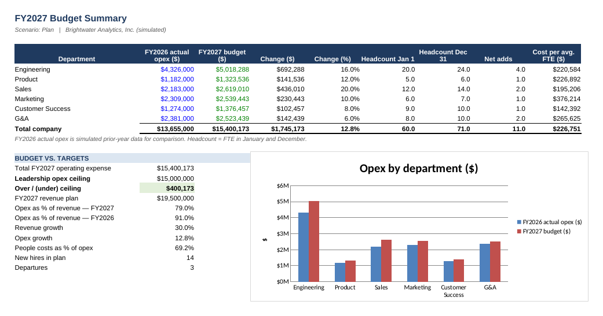
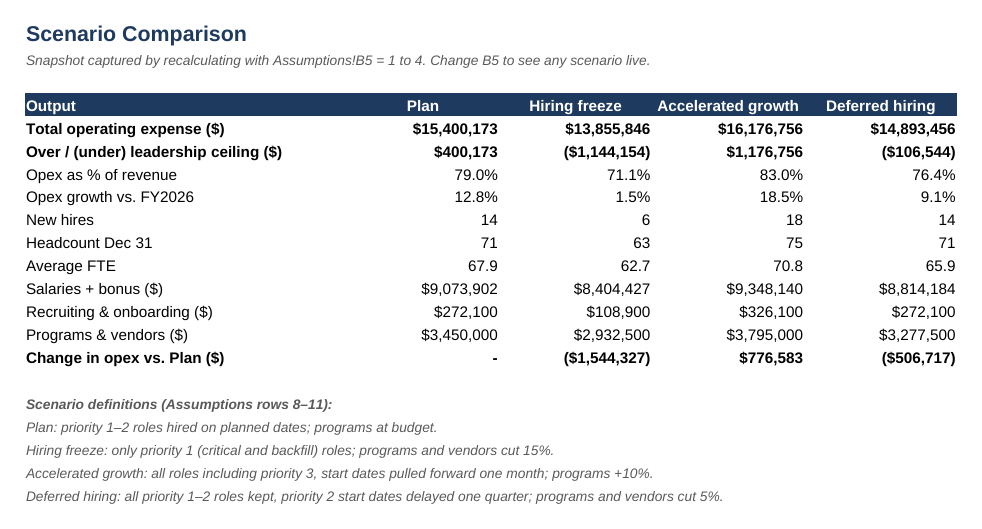

# Headcount & Operating Expense Planning Model — FY2027

A monthly, driver-based operating expense budget for **Brightwater Analytics, Inc.**, a simulated ~70-person software company. The model is built bottom-up from an employee roster and a hiring plan, rolls up by department, and tests four hiring scenarios against a leadership spending ceiling. All data is fictional and built for illustration. Open [`Headcount_OpEx_Planning_Model.xlsx`](Headcount_OpEx_Planning_Model.xlsx) to explore it.

## The planning question

Leadership set a **$15.0M ceiling** on FY2027 operating expense, with revenue planned to grow 30% to $19.5M. The department hiring plans add up to **$15.4M — $400K over the ceiling**. Which option gets the budget under the ceiling without giving up the growth hires?

## Scenario results

| | Plan | Hiring freeze | Accelerated growth | Deferred hiring |
|---|---|---|---|---|
| Total operating expense | $15.40M | $13.86M | $16.18M | **$14.89M** |
| Over / (under) $15.0M ceiling | $400K | ($1.14M) | $1.18M | **($107K)** |
| New hires | 14 | 6 | 18 | **14** |
| Headcount, Dec 31 | 71 | 63 | 75 | **71** |
| Opex as % of revenue | 79.0% | 71.1% | 83.0% | **76.4%** |

- **Hiring freeze** (priority 1 roles only, programs −15%) gets well under the ceiling but cancels 8 planned hires, including security, machine learning and FP&A roles on the roadmap.
- **Accelerated growth** (all 18 roles, one month earlier, programs +10%) is $1.18M over.
- **Deferred hiring** is the recommendation. It keeps all 14 planned hires and reaches the same year-end headcount. The eight priority-2 hires start one quarter later, and programs and vendor spend are trimmed 5%. That saves $507K vs. Plan and lands $107K under the ceiling. Delaying hires alone saves $334K, which is not enough on its own.

## Plan budget highlights

- Opex grows **12.8%** ($13.66M → $15.40M) while revenue grows 30%. Opex falls from 91% to 79% of revenue.
- People costs (salaries, bonus, payroll taxes, benefits) are **69%** of total opex.
- Engineering drives the largest dollar increase (+$692K, +16%), from 4 net adds. Sales grows fastest (+20%) because of variable compensation and travel for the new account executives.
- Three planned departures are backfilled; backfills are priority 1 and survive every scenario.

## How it works

| Sheet | What it does |
|---|---|
| Cover | Live key outputs for the selected scenario and a tie-out check |
| Assumptions | Scenario selector (B5), compensation and per-head cost rates, bonus targets by level, department drivers, revenue and the opex ceiling |
| Roster | 60 current employees and 18 open roles: department, level, salary, start and end dates, hiring priority |
| Headcount Calc | Prorated FTE and salary for every person in every month, including a 3.5% April merit increase and departures |
| Department Budget | Monthly budget for six departments across ten line items, rolled up to a company total |
| Summary | FY2027 budget vs. FY2026 actual and the ceiling, headcount bridge, cost per FTE and a department chart |
| Scenarios | All four scenarios side by side |

**Cost drivers:**
- **Salaries** are prorated by days employed in each month. Bonus targets range from 5% to 20% by level; Sales uses 30% on-target variable pay instead.
- **Payroll taxes:** 7.2% of salary plus bonus.
- **Per-FTE costs:** benefits $1,150, software $250, facilities $600 and travel by department, each per FTE per month.
- **Recruiting:** 15% of each new hire's salary plus $3,000 for onboarding, booked in the start month.
- **Programs and vendors:** an annual budget per department, spread evenly across the year.

Every input is a labeled cell, so changing a salary, start date or hiring priority in the Roster updates the whole budget.

*Tools: Excel (SUMIF/SUMPRODUCT roll-ups, EOMONTH/EDATE date logic, INDEX-based scenario selector).*
